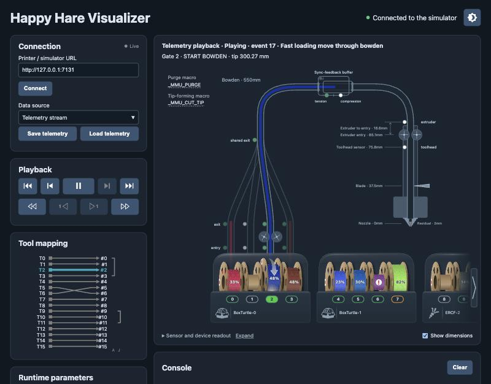

# Happy Hare Console



A web interface for [Happy Hare](https://github.com/moggieuk/Happy-Hare) that animates what the MMU
is doing: the filament in every gate, the selector, gears, sensors, buffer, spools and toolhead, live
or replayed from a recording. It installs beside Mainsail or Fluidd and talks to the printer through
Moonraker, as they do.

It is plain ES modules, CSS and one `index.html`. There is no build step and nothing to compile.

## What you need

- A printer running Klipper, Moonraker and Happy Hare v4.
- nginx, which Mainsail and Fluidd images already include.
- For animated movement, a Happy Hare version with motion telemetry (after v4.2.0) and telemetry
  turned on (`default_telemetry_mode` in `mmu.cfg`, or `MMU_TELEMETRY`). Without it the Console still
  follows the printer's live status.

## Install

On the printer:

```bash
cd ~
git clone https://github.com/moggieuk/Happy-Hare-Console.git
cd Happy-Hare-Console
./install.sh
```

The installer does two things and prints the Console's address when it finishes:

1. **Adds an nginx site of its own**, beside Mainsail or Fluidd, on the first free port from 8090 (for
   example `http://<printer>:8090/`). It serves the `console/` folder and proxies `/websocket` and the
   Moonraker API paths to Moonraker, exactly as Mainsail's own site does, so the page and the API share
   an origin and nothing needs adding to `cors_domains`.
2. **Registers the checkout with Moonraker's update manager**, so the Console appears in the update
   list of Mainsail and Fluidd. Restart Moonraker once to see it there.

It asks before using `sudo`, runs `nginx -t` before reloading, and puts the old configuration back if
nginx rejects it. Running it again keeps the same port.

| Option | Does |
|---|---|
| `-p <port>` | First port to try for the Console (default 8090) |
| `-m <port>` | Moonraker's port (default 7125) |
| `-c <dir>` | Klipper config directory holding `moonraker.conf` (default `~/printer_data/config`) |
| `-y` | Answer yes to the prompt |
| `-u` | Uninstall |

### Updating

Use the update manager in Mainsail or Fluidd, or run `git pull` in the checkout. The site serves the
checkout directly, so there is nothing to reinstall.

The entry the installer adds to `moonraker.conf`:

```ini
[update_manager happy-hare-console]
type: git_repo
path: ~/Happy-Hare-Console
origin: https://github.com/moggieuk/Happy-Hare-Console.git
primary_branch: main
```

### Uninstalling

```bash
./install.sh -u
```

This removes the nginx site and the update manager entry. No other site is touched. Delete the
checkout afterwards if you no longer want it.

### Troubleshooting

- **nginx was not found.** The installer says so and changes nothing. Install nginx with your system's
  package manager, or host the folder another way (below).
- **The page shows a 403.** nginx's user cannot read the folder, usually because the home directory is
  private. Allow it to be traversed with `chmod o+x ~`.
- **Access.** The site exposes the same Moonraker API as Mainsail does on its port; Moonraker's own
  authorization rules apply.

## Other ways to host it

Any static web server can serve the `console/` folder. The page connects to Moonraker at its own
origin, so either proxy Moonraker's paths as `nginx/happy-hare-console.conf` does, or set the
connection address in the page and allow the page's host in Moonraker's `cors_domains`.

A recording (`.jsonl`) can be loaded and played with no printer at all.

## Development

```bash
make serve        # the Console at http://127.0.0.1:8000/
make test         # JavaScript tests and installer tests
make lint         # ruff
make spellcheck   # CSpell
```

`make test` needs Node.js 22 or later and Python 3. The same checks run on every pull request.
Pull request titles follow conventional commits (`feat`, `fix`, `chore` or `docs`).

[console/README.md](console/README.md) describes the modules, the data sources, how telemetry is drawn
and the fixtures.

## License

GPL-3.0, the same as Happy Hare. See [LICENSE](LICENSE).
